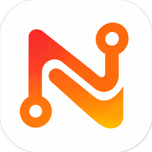
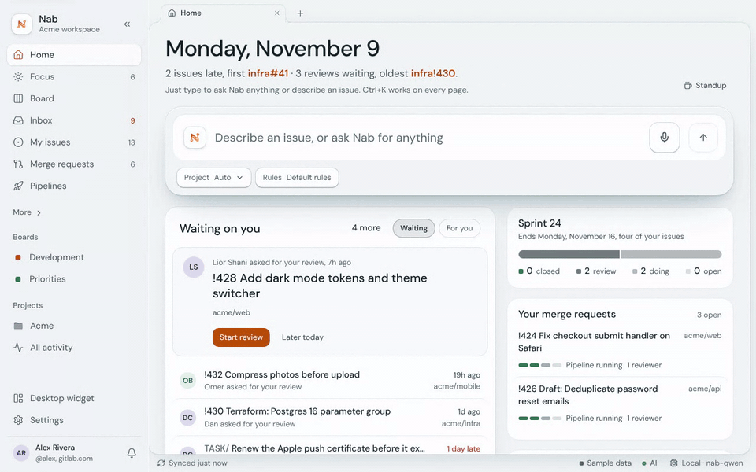
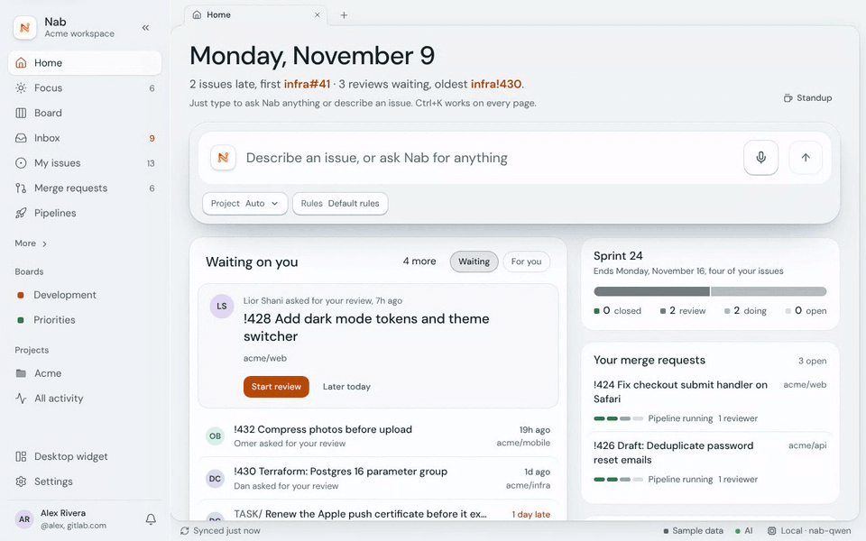
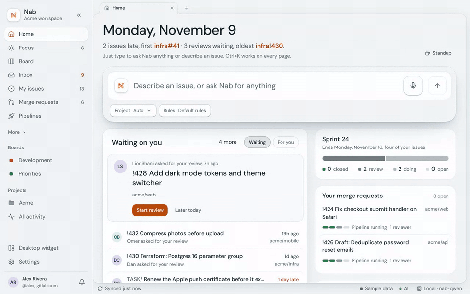
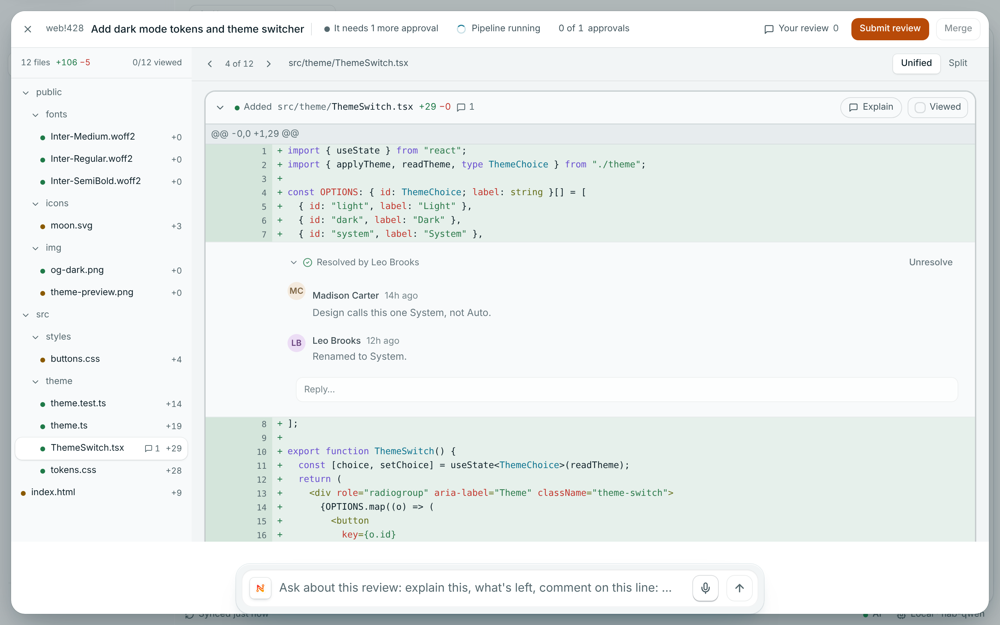
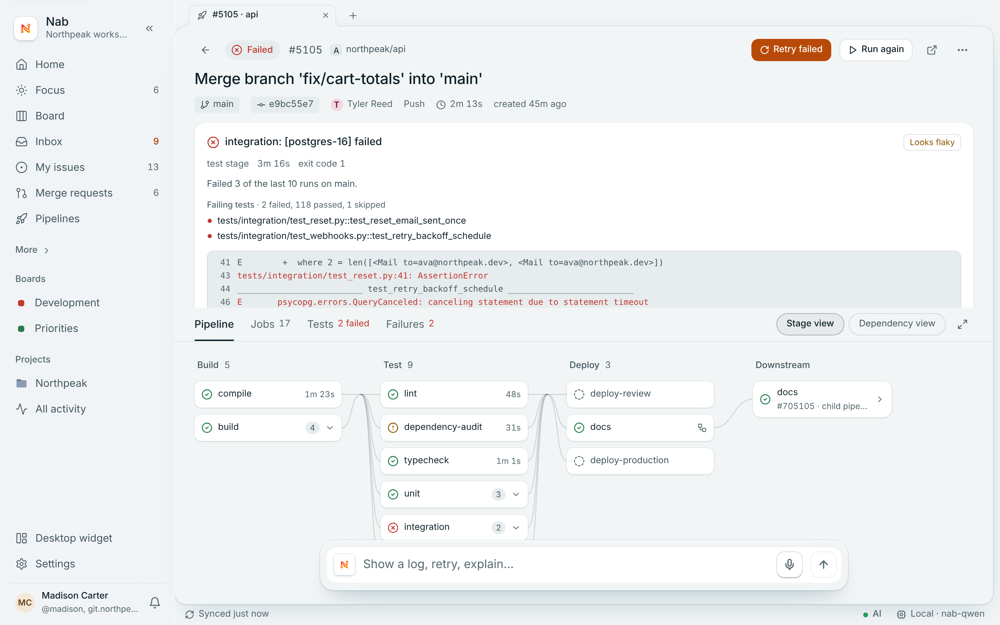
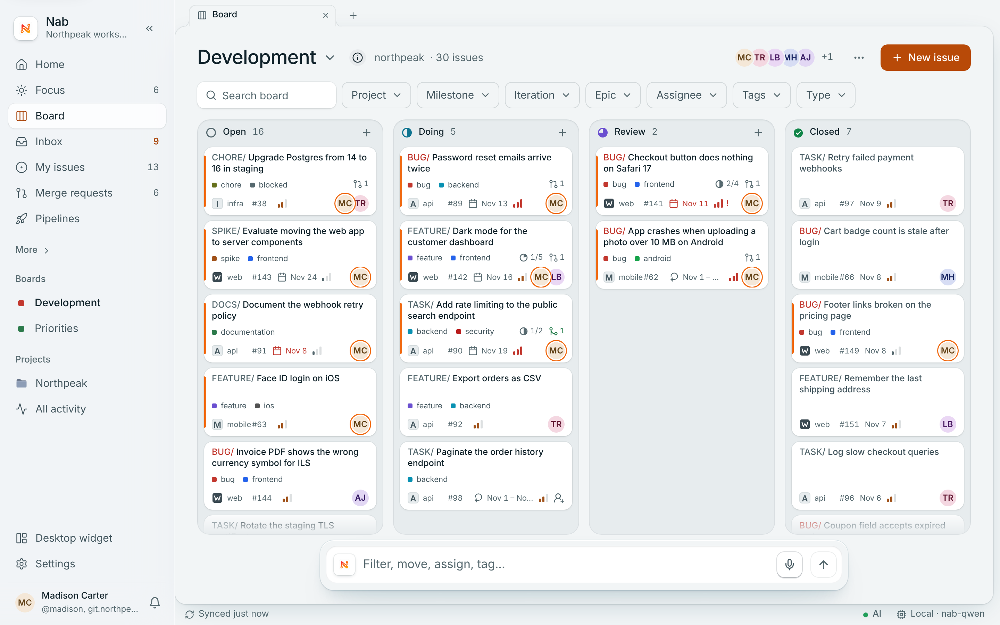
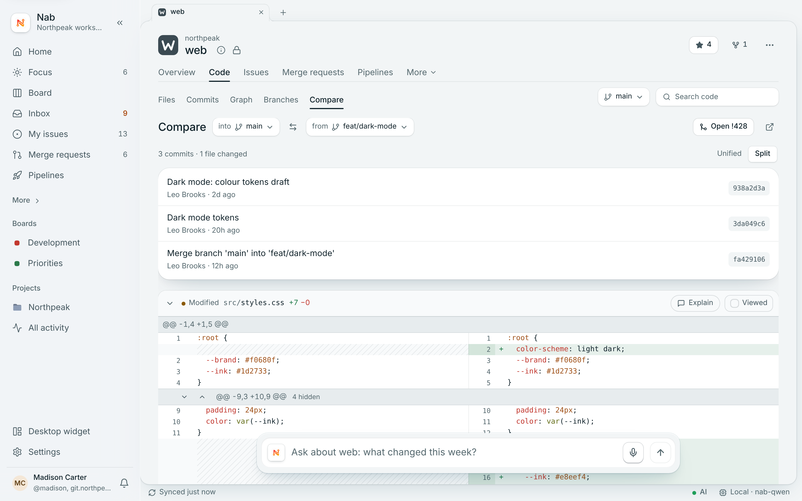

<h1 align="center">Nab</h1>

<h3 align="center">Your GitLab, at the speed of your keyboard. Issues, merge requests and pipelines in one fast desktop app, with an AI assistant that runs on your own computer.</h3>

  
  
  
  

**Less clicking. More shipping.** Nab works with GitLab.com and self-managed GitLab.

## An assistant that thinks

Nab's AI runs on your computer. Ask it a real question and it weighs your issues before it answers, then explains itself when you ask "why?".

Or just tell it what to do. It does it, offers Undo, and knows what "it" means next.

## What you get

- **Home that knows your day.** What's waiting on you, your sprint, your merge requests and the pipeline that just
  failed, on one page. **Focus** keeps your own short list for today, with notes and meetings next to your issues.
- **One inbox.** Mentions, assignments, review requests and due dates in one stream. `E` marks done, `S` snoozes,
  `F` adds to Focus. Done in Nab is done in GitLab.
- **Your board, live.** Drag cards between columns, filter by project, milestone, iteration, people or tags, and add
  an issue straight into a column. Every change goes to GitLab right away.
- **Review merge requests properly.** The file tree, unified or split diffs, click a line to comment, threads you can
  reply to and resolve, approvals, rebase and merge, with a plain-words reason when a merge is blocked.
- **Read the code.** Browse files, commits, the commit graph and branches, and compare any two branches side by side.
- **Pipelines without the tab maze.** Stages and jobs at a glance, the full job log inside the app, and the
  **pipeline doctor**: which tests failed, the lines that matter, and whether it looks flaky.
- **Ask in plain English.** "Which merge requests are waiting for my review?" Then "which of those have a failing
  pipeline?" Nab understands follow-ups. Describe a bug in one sentence and it drafts the issue with your team's rules
  (title prefix, labels, assignee), checks for duplicates, and asks before it creates anything.
- **Quick Ask, from any app.** `Ctrl+Alt+N` (`⌥Space` on macOS) opens a small bar over whatever you're doing:
  type "make an issue about…" and you're back to work.
- **Keyboard-first.** Every action has a shortcut, `Ctrl+K` / `⌘K` works on every page, and `?` shows them all.
- **Never miss what matters.** Notifications for failed pipelines, mentions, reviews and due dates, from the tray,
  even with the window closed.
- **Your accounts, your team.** Several GitLab accounts at once, shared team rules, light and dark themes, a desktop widget.

## Privacy

- **Your tokens stay in your keychain.** GitLab tokens and AI keys are kept only in your system's keychain
  (Windows Credential Manager, macOS Keychain, or GNOME Keyring / KWallet on Linux), never in a file.
- **The AI runs on your computer.** By default Ask Nab uses [Ollama](https://ollama.com) on your own machine, so
  your questions, issues and code never leave it. A cloud AI (Anthropic or OpenAI-compatible) is optional and off
  until you add your own key.
- **What leaves your computer:**
  - requests to your own GitLab server(s), to read and change what you ask for;
  - if you choose a cloud AI: your question and the issue or code text it needs, sent to that provider under its terms;
  - a check for updates (a small file from this page) and, when you say yes, the update itself;
  - the downloads you start: Ollama (on Windows, from ollama.com) and Nab's AI model.
- **No Nab server, no tracking.** Nab has no account, no server of its own and no usage statistics.
- **Updates are signed.** Nab only installs an update signed with Nab's own key, and always asks first.

## Install

1. Download the latest version from **[Releases](https://github.com/itay5731/Nab-releases/releases/latest)**.
2. **Windows (10 and 11):** run `Nab_<version>_x64-setup.exe` (or the `.msi`). The installer isn't signed yet, so
   Windows may say "Windows protected your PC": click **More info → Run anyway**.
3. **macOS (Intel and Apple Silicon):** open `Nab_<version>_universal.dmg` and drag Nab to Applications. The app
   isn't notarized yet, so the first time macOS says it can't check it:
   - open Nab once (it's blocked), then go to **System Settings → Privacy & Security**, scroll down and click
     **Open Anyway** next to Nab, and confirm;
   - or, in Terminal: `xattr -dr com.apple.quarantine /Applications/Nab.app`.

   After that Nab opens normally, and updates keep working.
4. **Linux (x64):** use the **AppImage** (`chmod +x Nab_<version>_amd64.AppImage`, then run it; it updates
   itself) or the **.deb** for Debian and Ubuntu (`sudo apt install ./Nab_<version>_amd64.deb`). Nab keeps your
   token in the Secret Service, which GNOME and KDE run already (GNOME Keyring or KWallet).
5. **Sign in to GitLab.** Click **Sign in with GitLab**, approve Nab in your browser, and you're in. Or use a
   **personal access token**: GitLab → Preferences → Access tokens, scopes `api` and `read_user`, then paste it under
   **Other ways to sign in**. On your own GitLab server, enter its address first.
6. **Turn on the AI (optional).** On Windows, Nab installs Ollama for you with one click. On macOS and Linux, install
   [Ollama](https://ollama.com/download) first (Linux: `curl -fsSL https://ollama.com/install.sh | sh`), then choose
   **Settings → AI → On this computer** and download the model.

Nab checks for updates by itself, shows what's new, and installs only when you say so.

## FAQ

**Can the AI be faster?** If you installed Ollama yourself, set these once and restart Ollama (Nab sets them for you when it installs Ollama):
`OLLAMA_FLASH_ATTENTION=1`, `OLLAMA_KV_CACHE_TYPE=q8_0`, `OLLAMA_MAX_LOADED_MODELS=2`. Laptops: plug in the charger, since GPUs slow down a lot on battery or a weak charger.

**Does my code or my issues go to an AI company?**
Not unless you choose a cloud AI and add your own key. The default AI runs on your computer through Ollama.

**What does the local AI need?**
Ollama 0.17.4 or newer and about 6 GB of disk for Nab's model. 16 GB of memory is recommended; on smaller machines
Nab suggests a lighter model. Without any AI, everything else in Nab works.

**Does it work with self-managed GitLab?**
Yes. Enter your server's address when you sign in. Several accounts, on different servers, work side by side.

**Which GitLab plan do I need?**
Any, including Free. Features that GitLab itself only offers on paid plans (like epics or iterations) show up when
your plan has them.

**Will Nab change things in GitLab without asking?**
What you do yourself (drag a card, close an issue, approve) goes to GitLab right away, as on the website. When the
AI is about to create or change something, it shows you first and waits for your OK.

**Where is my token kept?**
In your system's keychain, and nowhere else. Sign out in Settings to remove it.

**Can I use it offline?**
You can read what Nab has already loaded. Changes need a connection to your GitLab.

**How do updates work?**
Nab checks this page a few seconds after it starts and every 6 hours. When there's a new version, it shows what's new
and installs only when you click Update. Every update is checked against Nab's signature first.

**Why does Windows or macOS warn me the first time?**
Nab isn't signed with a paid Microsoft or Apple certificate yet. The steps under Install open it safely once; after
that it starts like any other app.

**Does Nab install Ollama on macOS and Linux?**
Not yet: there you install Ollama yourself from ollama.com, and Nab finds it. On Windows Nab can install it for you.

**Is Nab affiliated with GitLab?**
No. Nab is an independent app that works with GitLab.

**How do I uninstall?**
Windows: Settings → Apps → Nab → Uninstall. macOS: drag Nab from Applications to the Trash. Linux: delete the
AppImage, or remove the Nab package with your package manager. Your token is removed from the keychain when you sign out first.

## License

Nab is free to use but not open source. See [LICENSE](LICENSE). © 2026 Itay Nadir, all rights reserved.
Nab includes open-source components under their own licenses: [THIRD_PARTY_NOTICES.md](THIRD_PARTY_NOTICES.md).

GitLab is a trademark of GitLab Inc. Nab is not affiliated with or endorsed by GitLab Inc.
